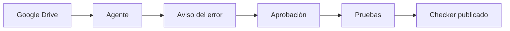

# Checker de documentos

Checker hecho para los documentos de **Masterview S.A.**, un freight forwarder. El formato cambia según lo que envía cada cliente, y el checker se actualiza para seguir ese cambio.

App publicada: https://ndresdavila.github.io/masterview-document-checker/

## Cómo se mantiene

Los documentos están en Google Drive. Un agente de Cursor, con Grok, los revisa cada día y también cuando aparece una incongruencia. Comenta el error y espera aprobación. Después se corrige, se prueba y se publica la versión nueva del checker.

